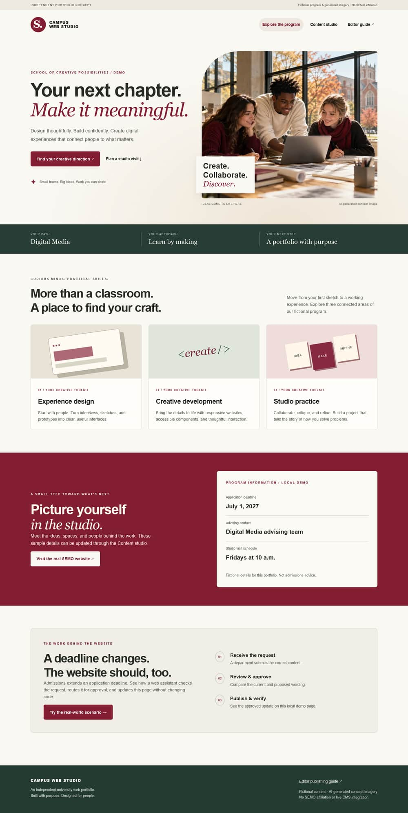

# Campus Web Studio

An independent university web portfolio built around a real maintenance problem: a department changes a deadline, an editor submits the correction, a reviewer checks it, and the approved update appears on the program page.




## Run the website

Install Node.js 22.12+ (24 also supported), then:

```powershell
npm.cmd ci
npm.cmd run dev
```

Open the local URL printed by Vite. On macOS/Linux, use `npm` instead of `npm.cmd`. Keep the terminal running. The `.cmd` form avoids Windows PowerShell execution-policy errors without changing system security settings.

Open Content studio. Reset demo tickets if you used an older version. Move **Update application deadline** through In review → Approved → Published, then choose View updated program. Drafts stay unpublished. Published changes persist in this browser. You can submit your own correction to the deadline, advising contact text, or studio visit schedule.

## Run the local Cascade-style sandbox

Install an open-source JDK 17+ (21 recommended), with `java` and `javac` on PATH:

```powershell
npm.cmd run test:velocity
npm.cmd run sandbox
```

Open http://127.0.0.1:4192. Edit structured fields, save XML, and render a preview through the real Apache Velocity 2.4.1 engine. The first run downloads three pinned JAR versions from Maven Central. The saved XML is in ignored `work/sandbox.xml`. Only trusted local template files are executed. The server binds to loopback and is an educational lab, not a production service.

Cascade's proprietary tools are represented by small local adapters. The original Format is executed, including XPath selection, repeated fields and escaping. This is stronger evidence than an unexecuted code snippet, but does not establish hands-on use of the commercial CMS. See [the sandbox guide](cascade/README.md).

## Verify the work

```powershell
npm.cmd test
npm.cmd run test:velocity
npm.cmd run images
npm.cmd run build
npm.cmd run check:links
npm.cmd run check:seo
npx.cmd playwright install chromium firefox webkit
npm.cmd run test:e2e
```

Browser tests run against the production build and start the website and Java lab automatically. Install Java before running them. For a subset: `npx.cmd playwright test --project=chromium --project=webkit`. Firefox cannot launch in this Windows execution environment; the full three-engine suite is configured for GitHub's Linux CI. Do not interpret a configured browser as a verified pass until its run succeeds.

The checks cover native form errors, text injection, page updates, persistence, audit history, keyboard-only submission, heading focus, 320px reflow, 200% text and WCAG spacing together, forced-color/reduced-motion emulation, no-JavaScript public content, rendered internal links/images, metadata, raw axe results and Velocity previews. WebKit's skip-link test explicitly focuses the link before keyboard activation because its default Windows Tab cycle omits links; Chromium/Firefox check Tab discovery.

See [validation evidence](docs/validation.md) and [accessibility assessment](docs/accessibility.md). Automated tests and accessibility trees do not substitute for a human screen-reader evaluation or establish full WCAG conformance.

## SEO and deployment

The public page is prerendered to actual HTML, then hydrated by React. It remains readable without JavaScript. Builds generate social metadata and an image, favicon and robots rules. A configured deployment URL also generates canonical URLs and a sitemap for the two real public URLs. Program/studio are views of the same URL, not separate indexable pages.

Local builds default to **noindex**, so test content is not accidentally indexed. For a public deployment in PowerShell:

```powershell
$env:SITE_URL = 'https://aerofa45.github.io/Web_GA_Demo/'
$env:INDEXABLE = 'true'
npm.cmd run build
npm.cmd run check:seo
```

Replace SITE_URL for a different host. Root and subdirectory hosting are supported. Upload `dist/` to a static host. GitHub Pages automation is included for this repository; Pages must be configured to use GitHub Actions. The Java lab runs locally and is not part of static hosting. Search ranking and field Core Web Vitals are not guaranteed by metadata or a local audit.

For a local mobile Lighthouse lab report, run `npm.cmd run serve:built` in one terminal and `npm.cmd run audit:performance` in another. Chrome is supplied by Playwright. The report records its URL, time, scores and metrics in `evidence/`. The recorded mobile lab run measured performance 89, accessibility 100, best practices 100 and SEO 100 (LCP 2.1 seconds; CLS 0). Performance varies with hardware and system load.

## Image editing evidence

The generated source was opened in **miniPaint**, an open-source browser image editor. It was resized from 1536×1024 to 1280×853, cropped by reducing the canvas to 1200×800 without autoresize, and exported as JPEG at quality 82. The editable layer project and settings/canvas screenshots are included in `evidence/`. Sharp generates responsive WebP/JPEG derivatives from that edited export without upscaling. This demonstrates an equivalent image-editing workflow; it does not claim Adobe Photoshop was used.

[Image workflow and evidence](docs/images-and-photoshop.md) · [generated-image prompt and provenance](docs/generated-image.md)

## Portfolio walkthrough and job fit

[Requirement assessment and practical use case](docs/requirements-and-use-case.md) · [design rationale](docs/design.md)

The project demonstrates HTML, CSS, JavaScript, React, Tailwind, Alpine, Velocity, local content workflows, image optimization, technical SEO and quality testing. 

The ticket dashboard is browser-local, with no login, role enforcement or collaborative editing. Anyone can take a valid transition. Browser storage is untrusted; use fictional data only. The Java lab has no commercial CMS account, production publish destination, user directory or vendor services.

## Git and collaboration

Use focused feature branches and explain the user problem, change, validation and remaining limits in each PR. A CI workflow and PR template are included. 

Implementation references: [React rendering](https://react.dev/reference/react-dom/server/renderToString), [WCAG 2.1](https://www.w3.org/TR/WCAG21/), [Apache Velocity](https://velocity.apache.org/engine/), [miniPaint](https://github.com/viliusle/miniPaint), [Cascade Formats](https://www.hannonhill.com/cascadecms/latest/articles/developing-in-cascade/script-formats/index.html).

On GitHub project Pages, robots.txt is served below the repository path; it cannot control the parent domain's root robots policy. Page-level robots meta tags control this build's indexing intent. The sitemap uses the actual configured deployment URLs.
